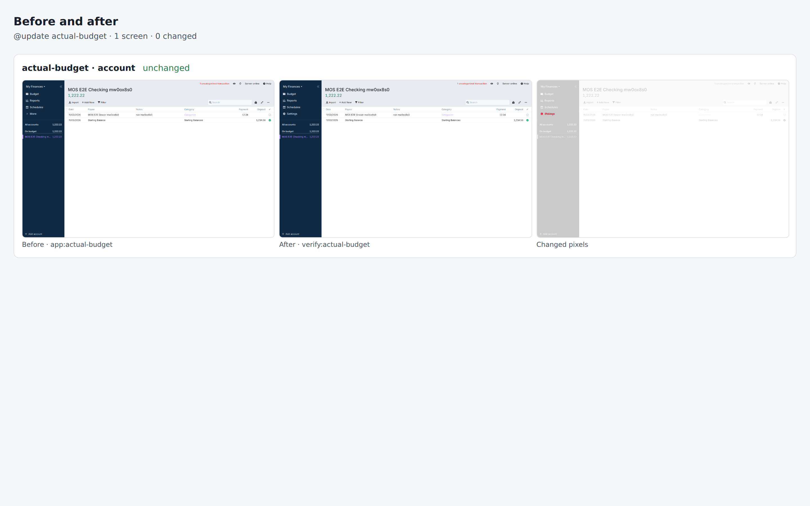

# actual-budget drill on 96b96b8d1490

Pull request: [#349](https://github.com/rpuls/my-own-suite/pull/349)

On `96b96b8d1490`: `@update actual-budget` passed, `@app-dr actual-budget` passed.

#### `@update actual-budget` passed

✓ reset · ✓ owner · ✓ dns01 · ✓ install:actual-budget · ✓ app:actual-budget · ✓ platform-update:wait · ✓ update:actual-budget · ✓ verify:actual-budget · ✓ routes · ✓ compare · ✓ network

- `app:actual-budget`: ✓ set the server password and open a budget · ✓ create an account with an opening balance · ✓ record a payment · ✓ budget money to a category
- `verify:actual-budget`: ✓ sign in and download the budget

##### Network: Problems

None.

#### `@app-dr actual-budget` passed

✓ reset · ✓ owner · ✓ dns01 · ✓ install:actual-budget · ✓ app:actual-budget · ✓ backup:bucket · ✓ reset · ✓ owner · ✓ restore:bucket · ✓ dns01 · ✓ verify:actual-budget · ✓ routes · ✓ network · ✓ cleanup

- `app:actual-budget`: ✓ set the server password and open a budget · ✓ create an account with an opening balance · ✓ record a payment · ✓ budget money to a category
- `verify:actual-budget`: ✓ sign in and download the budget

##### Network: Problems

None.

### update: before and after

