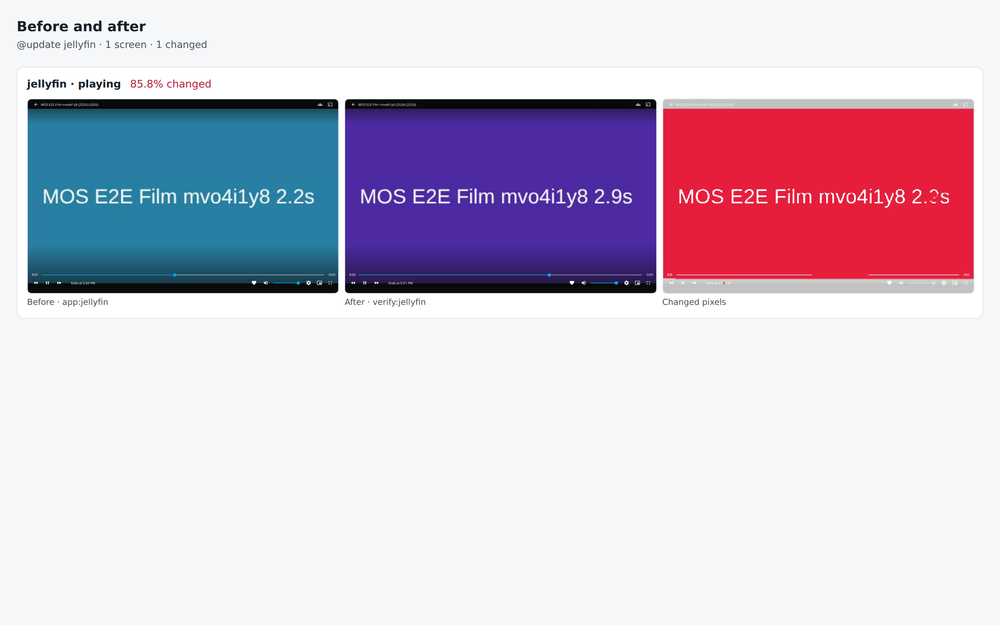

# jellyfin drill on 991dd31ff9d0

Pull request: [#339](https://github.com/rpuls/my-own-suite/pull/339)

On `991dd31ff9d0`: `@update jellyfin` passed, `@app-dr jellyfin` passed.

#### `@update jellyfin` passed

✓ reset · ✓ owner · ✓ drive · ✓ install:jellyfin · ✓ app:jellyfin · ✓ platform-update:wait · ✓ update:jellyfin · ✓ verify:jellyfin · ✓ routes · ✓ compare · ✓ network

- `app:jellyfin`: ✓ sign in as the administrator chosen at install · ✓ the Movies and Series libraries are already there · ✓ copy a film onto the drive and plug it back in · ✓ Jellyfin finds the film on its own · ✓ the film plays
- `verify:jellyfin`: ✓ sign in · ✓ the film on the drive is still in the library · ✓ and still plays

Screens that changed: jellyfin/playing 85.8%.

##### Network: Problems

None.

##### Network: jellyfin

Updated in `update:jellyfin`: Before is everything until that step, After is from it on.

| Host | Channel | From | Steps | Before | After | In review |
| --- | --- | --- | --- | --- | --- | --- |
| `repo.jellyfin.org` | server | app | app:jellyfin, verify:jellyfin | ✓ | ✓ | yes |
| `www.gstatic.com` | browser | jellyfin.mos.lab | app:jellyfin, verify:jellyfin | ✓ | ✓ | yes |
| `nyc2.mirror.jellyfin.org` | server | app | app:jellyfin, verify:jellyfin | ✓ | ✓ | yes |
| `tor1.mirror.jellyfin.org` | server | app | app:jellyfin | ✓ |  | yes |
| `api.themoviedb.org` | server | app | app:jellyfin | ✓ |  | yes |
| `www.omdbapi.com` | server | app | app:jellyfin | ✓ |  | yes |

New after the update: none.

#### `@app-dr jellyfin` passed

✓ reset · ✓ owner · ✓ drive · ✓ install:jellyfin · ✓ app:jellyfin · ✓ backup:bucket · ✓ reset · ✓ owner · ✓ restore:bucket · ✓ verify:jellyfin · ✓ routes · ✓ network · ✓ cleanup

- `app:jellyfin`: ✓ sign in as the administrator chosen at install · ✓ the Movies and Series libraries are already there · ✓ copy a film onto the drive and plug it back in · ✓ Jellyfin finds the film on its own · ✓ the film plays
- `verify:jellyfin`: ✓ sign in · ✓ the film on the drive is still in the library · ✓ and still plays

##### Network: Problems

None.

##### Network: jellyfin

| Host | Channel | From | Steps | In review |
| --- | --- | --- | --- | --- |
| `repo.jellyfin.org` | server | app | app:jellyfin, reset, restore:bucket | yes |
| `nyc2.mirror.jellyfin.org` | server | app | app:jellyfin | yes |
| `www.gstatic.com` | browser | jellyfin.mos.lab | app:jellyfin, verify:jellyfin | yes |
| `api.themoviedb.org` | server | app | app:jellyfin | yes |
| `www.omdbapi.com` | server | app | app:jellyfin | yes |
| `nyc1.mirror.jellyfin.org` | server | app | reset, restore:bucket | yes |

### update: before and after

