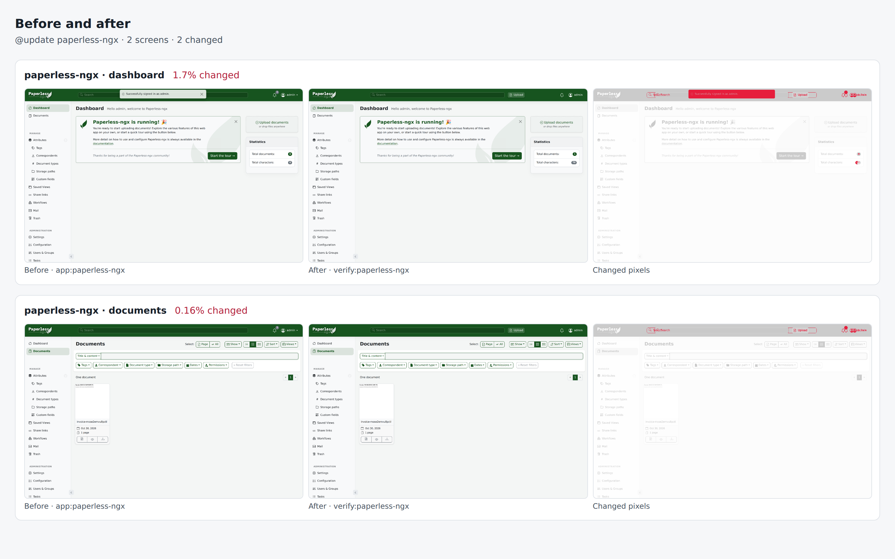

# paperless-ngx drill on 85472d29f154

Pull request: [#344](https://github.com/rpuls/my-own-suite/pull/344)

On `85472d29f154`: `@update paperless-ngx` passed, `@app-dr paperless-ngx` failed at `app:paperless-ngx`.

#### `@update paperless-ngx` passed

✓ reset · ✓ owner · ✓ install:paperless-ngx · ✓ app:paperless-ngx · ✓ platform-update:wait · ✓ update:paperless-ngx · ✓ verify:paperless-ngx · ✓ routes · ✓ compare · ✓ network

- `app:paperless-ngx`: ✓ sign in · ✓ upload a document · ✓ find it by its contents · ✓ its original and thumbnail are stored
- `verify:paperless-ngx`: ✓ sign in · ✓ the document and its search index are still there

Screens that changed: paperless-ngx/dashboard 1.7%, paperless-ngx/documents 0.2%.

##### Network: Problems

None.

#### `@app-dr paperless-ngx` failed at `app:paperless-ngx`

✓ reset · ✓ owner · ✓ install:paperless-ngx · ✗ app:paperless-ngx

- `app:paperless-ngx`: ✓ sign in · ✓ upload a document · ✓ find it by its contents · ✓ its original and thumbnail are stored

```text
Error: expect(locator).toBeVisible() failed
Locator:  getByText('invoice-mose2emvu8x334').first()
Expected: visible
Received: hidden
Timeout:  30000ms
Call log:
  - Expect "toBeVisible" getByText('invoice-mose2emvu8x334').first() with timeout 30000ms
  - waiting for getByText('invoice-mose2emvu8x334').first()
    62 × locator resolved to <p _ngcontent-ng-c476042145="" class="ms-2 mb-0 text-break">Document invoice-mose2emvu8x334.pdf was added to …</p>
       - unexpected value "hidden"
App page 1: http://paperless.mos.lab/documents?sort=created&reverse=1&page=1
  snapshot: test/e2e/results/20261030-003807-app-dr-paperless-ngx/failures/04-paperless-ngx-page-1.yaml
```

##### Network: Problems

None.

### update: before and after


