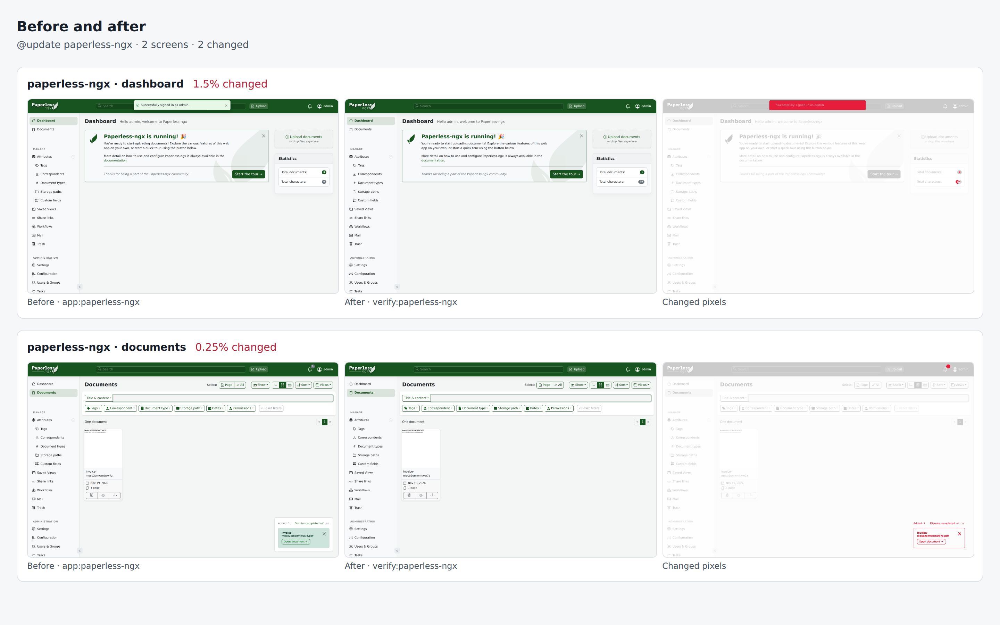

# paperless-ngx drill on a11027646a6b

Pull request: [#364](https://github.com/rpuls/my-own-suite/pull/364)

On `a11027646a6b`: `@update paperless-ngx` passed, `@app-dr paperless-ngx` passed.

#### `@update paperless-ngx` passed

✓ reset · ✓ owner · ✓ install:paperless-ngx · ✓ app:paperless-ngx · ✓ platform-update:wait · ✓ update:paperless-ngx · ✓ verify:paperless-ngx · ✓ routes · ✓ compare · ✓ network

- `app:paperless-ngx`: ✓ sign in · ✓ upload a document · ✓ find it by its contents · ✓ its original and thumbnail are stored
- `verify:paperless-ngx`: ✓ sign in · ✓ the document and its search index are still there

Screens that changed: paperless-ngx/dashboard 1.5%, paperless-ngx/documents 0.2%.

##### Network: Problems

None.

#### `@app-dr paperless-ngx` passed

✓ reset · ✓ owner · ✓ install:paperless-ngx · ✓ app:paperless-ngx · ✓ backup:bucket · ✓ reset · ✓ owner · ✓ restore:bucket · ✓ verify:paperless-ngx · ✓ routes · ✓ network · ✓ cleanup

- `app:paperless-ngx`: ✓ sign in · ✓ upload a document · ✓ find it by its contents · ✓ its original and thumbnail are stored
- `verify:paperless-ngx`: ✓ sign in · ✓ the document and its search index are still there

##### Network: Problems

None.

### update: before and after

