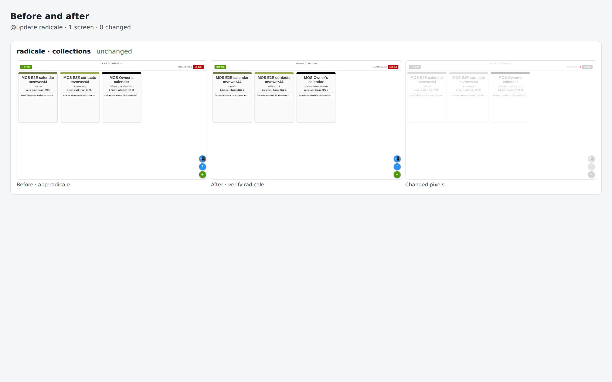

# radicale drill on 6a58fd737500

Pull request: [#338](https://github.com/rpuls/my-own-suite/pull/338)

On `6a58fd737500`: `@update radicale` passed, `@app-dr radicale` passed.

#### `@update radicale` passed

✓ reset · ✓ owner · ✓ install:radicale · ✓ app:radicale · ✓ platform-update:wait · ✓ update:radicale · ✓ verify:radicale · ✓ routes · ✓ compare · ✓ network

- `app:radicale`: ✓ sign in · ✓ create a calendar and an address book in the web UI · ✓ put an event over CalDAV and a contact over CardDAV
- `verify:radicale`: ✓ sign in · ✓ read the event and the contact back

##### Network: Problems

None.

#### `@app-dr radicale` passed

✓ reset · ✓ owner · ✓ install:radicale · ✓ app:radicale · ✓ backup:bucket · ✓ reset · ✓ owner · ✓ restore:bucket · ✓ verify:radicale · ✓ routes · ✓ network · ✓ cleanup

- `app:radicale`: ✓ sign in · ✓ create a calendar and an address book in the web UI · ✓ put an event over CalDAV and a contact over CardDAV
- `verify:radicale`: ✓ sign in · ✓ read the event and the contact back

##### Network: Problems

None.

### update: before and after

