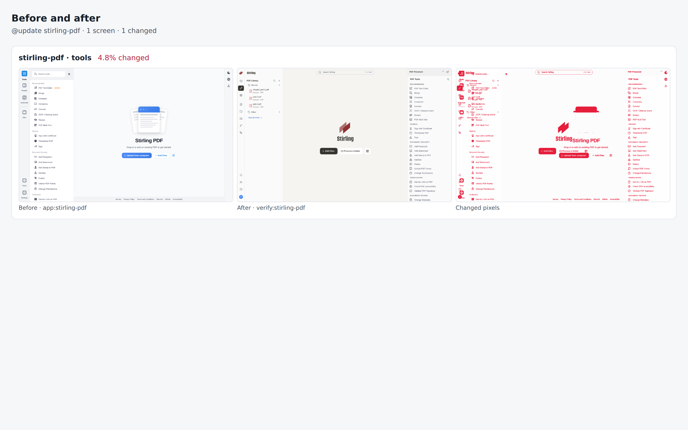

# stirling-pdf drill on 031528e4d7cc

Pull request: [#365](https://github.com/rpuls/my-own-suite/pull/365)

On `031528e4d7cc`: `@update stirling-pdf` passed, `@app-dr stirling-pdf` passed.

#### `@update stirling-pdf` passed

✓ reset · ✓ owner · ✓ install:stirling-pdf · ✓ app:stirling-pdf · ✓ platform-update:wait · ✓ update:stirling-pdf · ✓ verify:stirling-pdf · ✓ routes · ✓ compare · ✓ network

- `app:stirling-pdf`: ✓ sign in, replacing the default password · ✓ merge two PDFs and download the result
- `verify:stirling-pdf`: ✓ sign in with the password the journey set

Screens that changed: stirling-pdf/tools 4.8%.

##### Network: Problems

None.

##### Network: stirling-pdf

Updated in `update:stirling-pdf`: Before is everything until that step, After is from it on.

| Host | Channel | From | Steps | Before | After | In review |
| --- | --- | --- | --- | --- | --- | --- |
| `api.iconify.design` | browser | stirling-pdf.mos.lab | app:stirling-pdf | ✓ |  | no, before the update only |

New after the update: none.

#### `@app-dr stirling-pdf` passed

✓ reset · ✓ owner · ✓ install:stirling-pdf · ✓ app:stirling-pdf · ✓ backup:bucket · ✓ reset · ✓ owner · ✓ restore:bucket · ✓ verify:stirling-pdf · ✓ routes · ✓ network · ✓ cleanup

- `app:stirling-pdf`: ✓ sign in, replacing the default password · ✓ merge two PDFs and download the result
- `verify:stirling-pdf`: ✓ sign in with the password the journey set

##### Network: Problems

None.

### update: before and after

